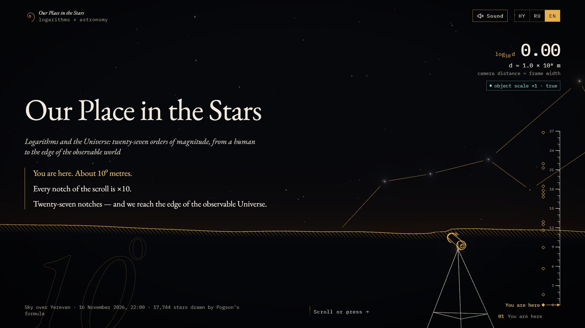
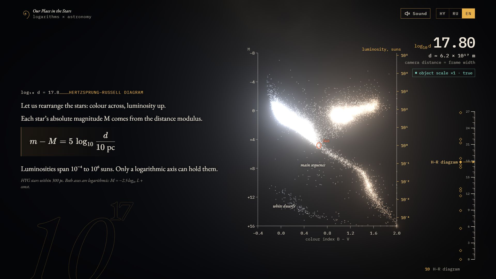
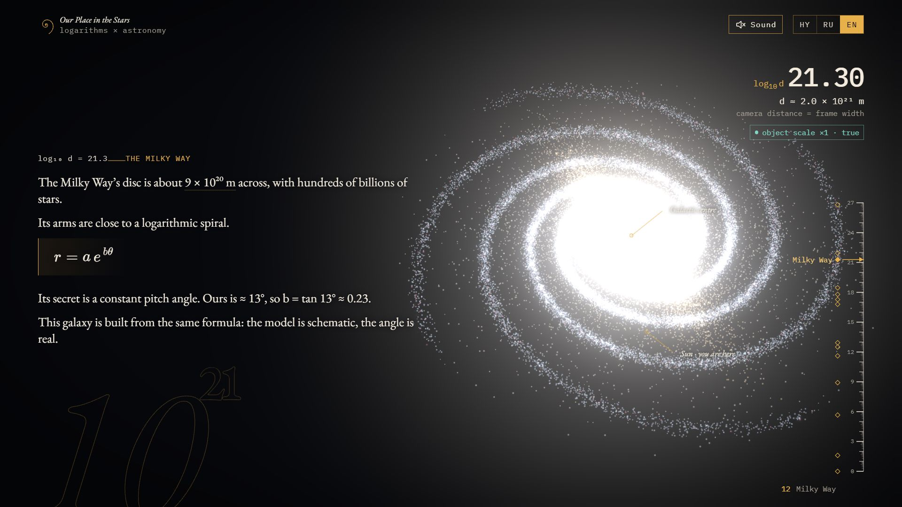
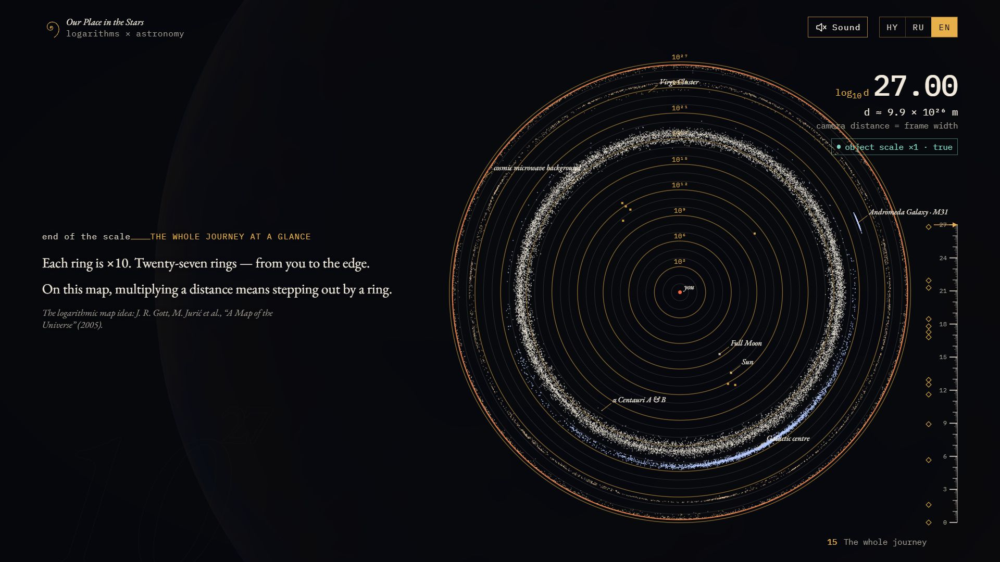

# Our Place in the Stars

**Live site: https://universe-with-log.vercel.app**

> **Հայերեն.** Ինտերակտիվ ճամփորդություն մեծության 27 կարգերով՝ մարդուց (10⁰ մ) մինչև դիտարկելի Տիեզերքի եզրը (~10²⁷ մ)։ Ոլորումը լոգարիթմական քանոն է. յուրաքանչյուր բաժանում՝ ×10։ Դպրոցական նախագիծ «Լոգարիթմներ և աստղագիտություն» թեմայով։
>
> **Русский.** Интерактивное путешествие через 27 порядков величины — от человека (10⁰ м) до края наблюдаемой Вселенной (~10²⁷ м). Прокрутка — это логарифмическая линейка: каждое деление — ×10. Учебный проект на тему «Логарифмы и астрономия».

An immersive one-page journey from a person looking at the night sky (10⁰ m) to the edge of the observable Universe (~10²⁷ m), built to be presented live on a classroom projector. Every stop shows where a logarithm hides: Napier’s tables, Tsiolkovsky’s rocket equation, Kepler’s third law, Pogson’s magnitudes, the Hertzsprung–Russell diagram, Weber–Fechner, the logarithmic spiral of galaxies, Cepheids and the distance modulus.

| | |
|---|---|
|  |  |
|  |  |

## The idea: the scroll *is* a slide rule

Scroll position is linear in **n = log₁₀ d**, where *d* is the camera distance in metres. Equal scroll distances mean equal *factors* (×10), so 27 orders of magnitude fit on one page. The camera’s horizontal field of view is 2·arctan(½) ≈ 53.13°, which makes the frame width at the focus exactly *d* — the HUD number means both “how far” and “how wide”.

The camera scale is always honest. Where planets have to be enlarged to stay visible, the HUD says so and shows the factor (“object scale ×4·10³ · enlarged”).

## Features

- **One WebGL renderer, 27 orders of magnitude.** Positions are kept in metres in float64 on the CPU; each frame renders `(position − camera) / 10ⁿ`, so float32 on the GPU never runs out of precision.
- **A real sky.** 17,744 stars from the HYG catalogue. Each frame, every star’s apparent magnitude is recomputed from the camera position with the distance modulus, and its brightness follows Pogson’s law. The hero shows the actual sky over Yerevan tonight at 22:00.
- **The Solar System today.** Planet positions and orbits from JPL’s Keplerian elements; the Moon from a low-precision lunar theory; the Earth with NASA day and night imagery.
- **Data you can rearrange.** The same stars fly into an H–R diagram with logarithmic axes.
- **Galaxies from a formula.** The Milky Way (4 arms, 13° pitch angle) and Andromeda (77° inclination) are generated from r = a·e^(bθ); Cepheid V1 blinks on its own label.
- **Interactive tools:** compare brightness (Δm ↔ flux ratio on two aligned scales), Kepler’s law on axes that morph from linear to logarithmic via the Box–Cox transform (x^λ − 1)/λ, and a working slide rule (A, C, D scales) with a step-by-step Mars-period demo.
- **Sound** (off by default): a procedural Web Audio drone whose pitch falls one octave every 13.5 orders of magnitude, plus a Weber–Fechner demo (+220 Hz vs ×2).
- **Three languages** (Armenian, Russian, English), numbers formatted per locale; every number on the site lives in one file (`src/content/facts.ts`), carries a source and is checked by unit tests.
- **Made for a projector:** presenter keys, a projector-contrast mode, a blackout key for clickers, an offline launcher, reduced-motion and no-WebGL fallbacks, a QR code on the final screen.
- **Easter eggs:** type `napier`, or click the spiral in the logo three times.

## Presenter controls

| Key | Action |
|---|---|
| `→` `PgDn` `Space` / `←` `PgUp` `Shift+Space` | next / previous stop |
| `Home` / `End` | start / sources |
| `1`–`9` | jump to a scene |
| `F` or `F5` | fullscreen |
| `M` | sound |
| `L` | language |
| `K` | projector mode (larger, higher contrast) |
| `B` or `.` | black screen (clicker button) |
| `H` or `?` | help |
| `Esc` | leave a tool / close |

URL options: `#b-pogson` (open at a stop), `?tier=low` (weak GPU), `?nogl` (static version), `?reduced` (no camera flights).

## Run locally

Requires Node 24 and pnpm 10.

```bash
pnpm install
pnpm dev        # http://localhost:5173
pnpm build      # type check, dictionary/glyph/path-case checks, production build to dist/
pnpm preview    # serve the build: http://localhost:4173
pnpm test       # unit tests for every number and formula
```

Offline on any Windows PC without Node: copy `dist/` next to `start-offline.ps1` and run
`powershell -ExecutionPolicy Bypass -File .\start-offline.ps1`.

## Stack

Vite · TypeScript · three.js (WebGL2) · GSAP (ScrollTrigger, SplitText) · Lenis · KaTeX · Web Audio API · Vitest · Playwright (screenshots and checks). No framework, no backend; all assets are local.

## Project structure

```
src/
  content/   facts.ts (every number + source), scenes.ts (stops), sources.ts
  core/      log-scroll (n ↔ scroll), float64 vector math
  gl/        renderer, post-processing, camera rig (a pure function of n), astronomy
  scenes/    stars (HYG), Earth, Solar System (JPL), belts, galaxies, cosmic web
  ui/        text reveals, HUD ruler, labels, cursor, keys, log map, easter eggs
  tools/     compare brightness, Kepler on log axes, slide rule, octaves
  audio/     procedural ambient and UI sounds
  i18n/      hy.json, ru.json, en.json, locale-aware number formatting
scripts/     data preparation (catalogue, fonts, textures), checks, screenshots, QR
tests/       unit tests for facts, formulas and ephemerides
```

## Team

A student team project for a mathematics and astronomy class — and our first deep dive into **frontend development and motion design**: real-time WebGL, scroll-driven camera choreography, typographic animation and sound design, all in the service of telling one mathematical story. A genuinely interesting experience for all of us.

## Sources

The full list (≈ 45 references) is on the last screen of the site and in [`src/content/sources.ts`](src/content/sources.ts). Key ones: Napier 1614; Briggs 1624; Kepler 1619/1627; Pogson 1856 (MNRAS 17); Leavitt & Pickering 1912 (HCO Circ. 173); Hubble 1925; Fechner 1860; Tsiolkovsky 1903; NASA NSSDC fact sheets; JPL planetary elements and Small-Body Database; IAU 2012 B2; Gaia DR3; SIMBAD; GRAVITY 2019; Vallée 2015; Tully et al. 2014; Planck 2018; Gott & Jurić 2005.

## Asset licences

- **Star catalogue:** HYG Database v4.4 by D. Nash (astronexus.com), CC BY-SA 4.0. The derived file `public/data/stars.bin` is shared under the same licence.
- **Earth imagery:** NASA Goddard Space Flight Center and NASA Earth Observatory, public domain (via Wikimedia Commons).
- **Fonts:** EB Garamond, Noto Serif Armenian, Noto Sans Armenian, IBM Plex Mono — SIL Open Font License 1.1.
- **Libraries:** three.js, Lenis, KaTeX (MIT); GSAP (Standard “no charge” License).

The licence for the project’s own code is to be chosen by the team.
